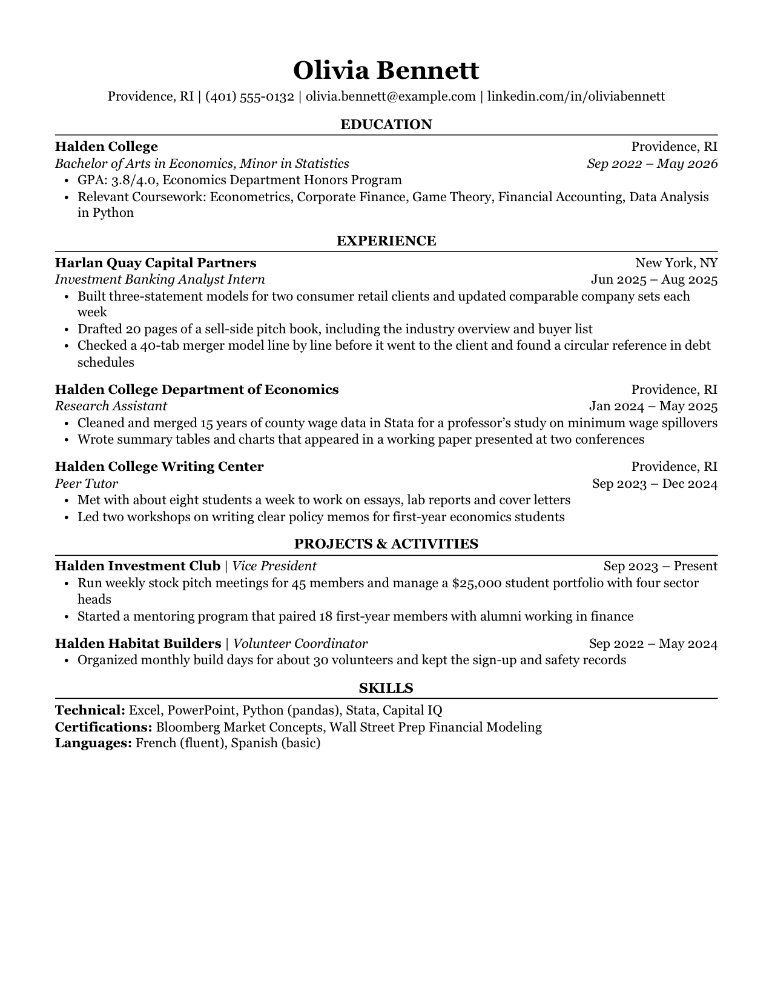

# Readable Resume for Eleventy

A one-page resume starter for [Eleventy](https://www.11ty.dev/). You write your
resume in a YAML file and get a web page that prints to a clean PDF: serif type,
centered section headings over a thin rule, education first. The layout is the
Classic template from [ReadableResume](https://readableresume.com), where the
same design is available for Google Docs and Word.

Demo: https://readableresume.com/eleventy-resume-template

[](https://readableresume.com/eleventy-resume-template)

Everything sits in one column with no tables, text boxes or icons, and the HTML
follows reading order, so the text comes out of the PDF in the order you read
it. That's the text applicant tracking systems parse.

The build is one HTML file with the CSS inline. No JavaScript, no web fonts, no
other files to serve.

## Getting started

You need Node.js 18 or later.

```sh
git clone https://github.com/supertj/eleventy-readable-resume.git my-resume
cd my-resume
npm install
npm start
```

Then open http://localhost:8080. The page rebuilds every time you save
`resume.yaml`.

## Editing your resume

Everything on the page comes from [`resume.yaml`](resume.yaml) in the project
root:

```yaml
name: Olivia Bennett
contact:
  - Providence, RI
  - (401) 555-0132
  - olivia.bennett@example.com
  - linkedin.com/in/oliviabennett
paper: letter

sections:
  - title: Experience
    entries:
      - company: Harlan Quay Capital Partners
        location: New York, NY
        title: Investment Banking Analyst Intern
        date: Jun 2025 – Aug 2025
        bullets:
          - Built three-statement models for two consumer retail clients
          - Drafted 20 pages of a sell-side pitch book
```

Section titles are set in capitals for you, so type them however you like.

Whether an entry has a `school`, a `company` or a `name` decides its layout:

| Has | Fields | Layout |
|---|---|---|
| `school` | `school`, `location`, `degree`, `date` | School and location on the first line, degree and dates in italics on the second. |
| `company` | `company`, `location`, `title`, `date` | Company and location first, then the job title in italics with the dates. |
| `name` | `name`, `role`, `date` | One line, "Name \| Role" with the dates on the right. For clubs, volunteering and projects. |

The other fields are optional, and `bullets` works on all three. Leave a field
out and it just isn't printed.

A section can also have `lines`, one per line, which is how the skills section
works. A line written as `Label: text` gets the label in bold:

```yaml
  - title: Skills
    lines:
      - Technical: Excel, PowerPoint, Python (pandas), Stata
      - Languages: French (fluent), Spanish (basic)
```

Or `text`, for a paragraph such as a short summary:

```yaml
  - title: Summary
    text: Economics graduate with two years of research experience in labor data.
```

Inline Markdown works in all of these: `**bold**`, `*italic*` and
`[links](https://example.com)`.

In the contact line, email addresses and anything starting with `https://`
become links. To link shorter text, give the item a `url`:

```yaml
contact:
  - text: github.com/oliviabennett
    url: https://github.com/oliviabennett
```

Links, here and in Markdown, get `rel="nofollow"`, apart from email and phone
links. Take the `rel` lines out of [`src/_data/resume.js`](src/_data/resume.js)
if you want search engines to follow them.

### Two YAML things to watch

- A bullet with a colon followed by a space, like `GPA: 3.8/4.0`, needs
  quotes. Without them YAML reads it as a field, and the build stops and tells
  you which section it's in.
- So does a line that starts with `*`, `#`, `&`, `!` or a quote mark.

A misspelled field name also stops the build with a message, rather than
quietly leaving something off your resume.

## Printing to PDF

Open the page in Chrome or Edge, press Ctrl+P (Cmd+P on a Mac), choose
**Save as PDF**, and untick **Headers and footers** under More settings. The
paper size and margins come from the page itself.

Set `paper: a4` in `resume.yaml` for A4. The margins switch from 0.6 in to
15 mm, the same as the Google Docs original.

Firefox and Safari print it too. Check that the paper size in their print
dialog matches, since they don't always pick it up from the page.

## Changing the design

- [`src/_includes/resume.css`](src/_includes/resume.css) has all the styling.
  Font sizes are in points so the printed page matches the original.
- [`src/index.njk`](src/index.njk) is the page template.
- [`src/_data/resume.js`](src/_data/resume.js) reads `resume.yaml`, checks it
  and turns each entry into lines. Add a new kind of entry there.

## Fonts

The design uses Georgia, which comes with Windows and macOS, so there's nothing
to install on those systems. Elsewhere, such as Linux or Android, the browser
falls back to Gelasio if you have it installed (it's free on Google Fonts and
drawn to Georgia's proportions), then to Times New Roman or the default serif.
A different font can change the line breaks, so print from a computer that has
Georgia if the page is close to full.

## Putting it online

```sh
npm run build
```

writes the page to `_site/index.html`. Because it's a single file with no
assets, it works from any folder: the root of a domain, a GitHub Pages project
site or a subfolder of another site, with no path prefix to set.

On Netlify, Vercel or Cloudflare Pages, use `npm run build` as the build
command and `_site` as the output directory.

The page shows everything in your contact line, phone number included, so
check that before you publish it.

## License

MIT. The person, schools and companies in the sample are made up.
